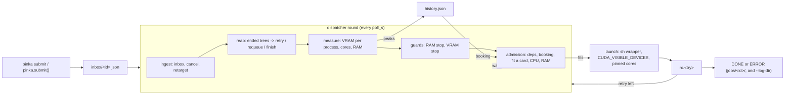

# pinka: reference

The complete reference for pinka, written for coding agents and for people who want the details. The storefront is
[README.md](README.md).

## What it is, and what it is not

pinka packs GPU jobs onto shared cards by measured memory. It is a job pool for one machine. Each job declares its
peak VRAM, cores and RAM. A dispatcher starts every job on a card with room, so several small jobs share one card.
Once a job has run long enough, or its name has a history, it is booked at the VRAM it actually used rather than at
what it declared. Jobs can depend on each other (`--after`) and be retried (`--tries`). Every job gets an exit-code
file and a DONE or ERROR marker, and the host's RAM is guarded. Python 3.9+, standard library only (pynvml
optional), no root, no database: the state is a directory of JSON files.

It fits one case: many jobs with uneven, roughly known memory needs (evaluation episodes, small trainings,
simulators) packed onto a few large cards by their measured footprint, with a spool any script, agent or shell can
write to.

It is not:

- a cluster scheduler: one machine, no network protocol (see Limitations);
- a whole-GPU queue: if each job needs a whole card, task-spooler (`ts -G`) or pueue is simpler;
- a sandbox: the spool has no authentication, and jobs run as the dispatcher's user;
- MIG- or MPS-aware: a card is one memory pool.

## Module map

| File | Role |
|:--|:--|
| `pinka/__init__.py` | public Python API: `Spec`, `submit`, `cancel`, `retarget`, `fanout`, `wait`; `__version__` |
| `pinka/__main__.py` | `python -m pinka` entry point (calls `cli.main`) |
| `pinka/cli.py` | argparse front end (`pinka` command); the read-only reports `list`, `show`, `status`, `usage`, `history`, `config` |
| `pinka/jobs.py` | client side: the `Spec` dataclass; submit / cancel / retarget / fanout by dropping files in `inbox/`, `cancel/`, `retarget/`; `wait` and job lookup (clients never write `state.json`) |
| `pinka/dispatcher.py` | the dispatcher, sole writer of `state.json`: each round ingests the spool, reaps ended trees (retry, requeue, finish), measures running jobs, runs the RAM and VRAM guards, accounts each card, admits and launches jobs, writes `usage.jsonl`, prunes; also the daemon loop and the lock |
| `pinka/booking.py` | pure functions: history keys, measured booking of VRAM / CPU / RAM, history defaults, same-key group shares |
| `pinka/batch.py` | `pinka run`: foreground mode for a JSON job list, with resume |
| `pinka/gpu.py` | GPU backends: `Nvml` (optional pynvml), `NvidiaSmi`, both cached; `Fake` (`fake:2x24`) and `NoGpu`; `backend()` picks one |
| `pinka/host.py` | host probes: process table (`/proc`, or `ps` elsewhere), owned process trees by (pid, start time) and env token, stopping trees, cores (affinity, cgroup quota), memory (cgroup v2 or host) |
| `pinka/config.py` | state directory resolution, `DEFAULTS` (every config key, commented), JSON read / atomic write helpers |
| `pinka/hooks.py` | site hooks `job_env`, `try_end`, `low_memory`, loaded from `module:function` or `/path/file.py:function` |

## A job's life



## Commands

Each job runs as `bash -c CMD` (one string) or as an argv list, in the submitting shell's directory and with its
environment (`--no-copy-env` uses the dispatcher's environment instead). Its output goes to
`~/.pinka/jobs/<id>/log.txt`, or to `--log-dir`.

All commands accept `--state-dir DIR` before the subcommand (default: `$PINKA_HOME`, else `$XDG_STATE_HOME/pinka`,
else `~/.pinka`).

| Command | What it does |
|:--|:--|
| `daemon [--once]` | the dispatcher loop (one per state dir; a second one exits) |
| `submit [flags] -- CMD ...` | queue a job, print its id |
| `fanout --arms a,b,c [--collect CMD] [flags] -- CMD` | one job per arm (`{arm}` in CMD, `--env` values and `--log-dir`), jobs named NAME-ARM, plus an optional CPU job after all of them (`{arms}` = every arm) |
| `run JOBS.json [--gpus] [--cpus] [--ram-gb] [--retry-failed]` | foreground mode (below) |
| `list [--all]` | running and queued jobs, and jobs that ended in the last 6 hours |
| `show ID` | full job record and log tail |
| `cancel ID ...` | cancel queued jobs or stop running ones |
| `retarget ID ... [--vram GB] [--ram GB] [--gpus 0,2]` | change a queued job's declaration or allowed cards; its id stays, so `--after` chains hold |
| `wait ID ... [--poll S]` | block until the jobs end; exit 0 if all are done |
| `status` | cards (used, booked by the pool, used outside it, free), CPU and RAM budget, idle cards next to waiting jobs |
| `usage [--hours H]` | card-hours split into computing, job running with GPU idle, queued (by cause), no work |
| `history [--all]` | per history key: runs, VRAM p95/max, cores, RAM; the learned same-key shares |
| `config` | the effective configuration |

Submit flags: `--name` (default: the command's first word), `--key` (history key), `--vram GB`, `--cpu N`,
`--ram GB`, `--exclusive` (whole card), `--gpus 0,2` (allowed cards), `--tag T` (per-card caps), `--priority P`
(higher first), `--after ID,ID`, `--when-exists PATH` (stay queued until the file exists), `--tries N`,
`--timeout-h H`, `--env K=V`, `--cwd`, `--log-dir`, `--owner`, `--no-copy-env`. If `--vram`, `--cpu` or `--ram` is
left out and the name has history, the default is p95 x 1.2 of earlier runs. A job with no history must declare
`--vram`.

### Python API

`pinka.submit(cmd, name=..., vram_gb=..., after=[...]) -> id`, `pinka.wait(ids)`, `pinka.cancel(id)`,
`pinka.retarget(id, vram_gb=...)`, `pinka.fanout(...)`. Every function takes `state=` (a state directory) and
otherwise resolves it as the CLI does; `submit` accepts any `Spec` field as a keyword.

### Environment of a job

The job's environment includes `CUDA_VISIBLE_DEVICES` (its card; empty for a CPU job), `CUDA_DEVICE_ORDER=PCI_BUS_ID`
(so CUDA numbers the cards as the driver and pinka do), `PINKA_JOB_ID`, `PINKA_GPU`,
`PINKA_TRY`, `PINKA_CPUS`, `PINKA_JOB_DIR`, `PINKA_LOG_DIR` and `PINKA_HOME`. A job with `--cpu N` also gets
`OMP_NUM_THREADS` and `MKL_NUM_THREADS` set to N unless its own env sets them. In the command and env values,
`{gpu}`, `{id}`, `{job_dir}` and `{try}` are replaced with the job's values. (`PINKA_RC` and `PINKA_TOKEN` are also
set; they are internal: the exit-code path for the wrapper, and the token that finds re-parented processes.)

Environment read by pinka itself: `PINKA_HOME` (state directory), `XDG_STATE_HOME` (fallback for it),
`PINKA_GPU_BACKEND` (forces `nvml`, `nvidia-smi`, `none` or `fake:...`; wins over the config), and
`CUDA_VISIBLE_DEVICES` of the dispatcher (limits the cards it uses when `cards` is unset).

### Foreground mode: run a list here

```bash
pinka run jobs.json [--gpus 0,1] [--cpus 16] [--ram-gb 64] [--retry-failed]
```

`jobs.json` is a list of job objects with any submit field (`gpu_gb` and `cpus` are accepted for `vram_gb` and
`cpu`); `after` names other jobs in the list:

```json
[{"name": "train", "cmd": ["python", "train.py"], "vram_gb": 40, "cpu": 8, "ram_gb": 32},
 {"name": "eval-a", "cmd": "python eval.py --part a", "vram_gb": 6, "after": ["train"], "tries": 2},
 {"name": "eval-b", "cmd": "python eval.py --part b", "vram_gb": 6, "after": ["train"], "tries": 2},
 {"name": "table", "cmd": "python table.py", "after": ["eval-a", "eval-b"]}]
```

The command runs the same dispatcher in the foreground, in a state directory of its own (`jobs.pinka/` next to the
list). It exits when every job has ended: 0 if all are done, 1 otherwise, after printing a table of the jobs. It also
exits, and reports why, when the remaining jobs can never start (one needs more VRAM than any card has, say).
Rerunning the same list skips jobs that are already done with an unchanged command. A job that failed gets one more
try, or all of its tries with `--retry-failed`. Anything a killed runner left running is stopped first. Ctrl-C or
SIGTERM stops every job. `CUDA_VISIBLE_DEVICES` on the runner (or `--gpus`) limits which cards it uses, so pinka can
work inside a reservation that another scheduler gave you. Job ids are the names; markers are
`jobs.pinka/jobs/<name>/DONE` or `ERROR`.

## How packing and booking work

Each round (`poll_s`, default 10 s), the dispatcher checks queued jobs in priority order, then in submit order. A job
whose `after` jobs are not done, or whose `--when-exists` file is missing, waits. A job whose `after` job failed or was
cancelled fails too. Then:

1. **Booking.** A job is booked at its declaration, at least at first. Its "history key" is its name with trailing
   run numbers removed, so `eval-s3` and `eval-12` share the key `eval`. Once 3 finished runs under a key exist, a
   new job is booked at `min(declared, 1.1 x p95 of their peaks + 1 GB)`. Once a running job is older than
   `settle_s` (600 s), its booking becomes `min(declared, max(history cap, 1.2 x its own peak + 1 GB))`. A running
   job always counts at least what it uses right now (from `nvidia-smi`, per process, summed over its process tree).
   A declaration that proved too low stops being a cap. A job measured above `1.1 x declared + 1 GB` is booked at
   `1.2 x its peak + 1 GB`, and its peak is written to history even if it fails. The next job under that key is then
   placed by what was measured.
2. **Same-key jobs on one card are booked together.** Jobs of one key on a card rarely all peak at once. From
   `usage.jsonl` (the last `conc_hours`, re-read every `conc_every_s`), the dispatcher learns per key how much VRAM
   n such jobs used together on a card: the p99 over card-minutes of the card's used VRAM / n, for every n with at
   least `conc_min` card-minutes; the key's share is the largest of these. m jobs of the key on a card then book
   `max(what they use now, min(the sum of their own bookings, max(m x conc_margin x share, the largest own
   booking)))`, for m up to the largest measured n plus one; further jobs book their own. Exclusive jobs and jobs
   above their declaration never join a group. `conc: false` turns this off; `pinka history` shows the learned
   shares.
3. **Fitting a card.** A card has room for a job when `total - headroom - (VRAM used outside the pool) - (pool
   bookings) >= need`. Of the cards with room, the least loaded wins (fewest jobs), and best fit breaks ties.
   Spreading keeps every card busy; best fit leaves room for a large job. `--exclusive` needs an empty card and
   takes all of it, and `tag_caps` limits how many jobs with a given tag share a card.
4. **CPU.** The CPU budget is `cpu_budget`, else the cores this process may use (affinity and cgroup quota) times
   `cpu_overcommit`. A job is charged its declared cores for its first `young_s` (300 s), then 1.2 x its measured
   peak over the last 5 minutes. On Linux, `--cpu N` pins the job to N free cores. A GPU job blocked only by the CPU
   budget still starts on a card that has been idle for `idle_s` (event `admit_idle`), so a card never waits on CPU
   bookkeeping.
5. **RAM.** A job starts only if `used + RAM still to come from young jobs + its RAM <= ram_frac x limit`. The limit
   is the cgroup v2 `memory.max` if one is set, else host RAM; "used" excludes reclaimable page cache. With
   `ram_budget_gb` (or `pinka run --ram-gb`), RAM is booked against that budget instead of being measured. Each job's
   memory is its tree's private memory (RssAnon + RssShmem), so files mapped by many jobs are not charged many times.
6. **No starvation.** A job blocked at the head of the queue for `hold_s` (15 min) reserves the card closest to
   fitting it. Lower-priority jobs stop starting there until it starts.
7. **Never fits.** A job that needs more than any allowed card offers says so in `list` ("never fits"), and `submit`
   warns. Fix it with `pinka retarget ID --vram GB`, or use `--exclusive` for a whole card.

### Guards on running jobs

- **VRAM over declaration**: an event, and a line in the job's `STATUS`. If the card has less than
  `over_stop_free_gb` free, the job furthest above its declaration is stopped and requeued (`oom_retries`), instead
  of a neighbour being hit by whichever allocation fails first.
- **CUDA out of memory** in this try's log: requeued `oom_retries` times beyond `--tries`.
- **SIGKILL from outside** (the kernel OOM killer, rc 137): requeued `kill_retries` times beyond `--tries`.
- **RAM over declaration**: an event. When the margin under the RAM line falls below `ram_stop_gb` (default 4 % of
  the limit), the job furthest above its declaration is stopped and requeued once, with its RAM declaration raised
  to what it measured. The kernel would otherwise kill the largest process, often a well-behaved training job.
- **Timeout** (`--timeout-h`), **cancel**: the whole process tree is stopped (SIGTERM, then SIGKILL).

Process trees are tracked by (pid, start time). A process re-parented to init is still found through its parent
chain or, on Linux, through a token in its environment. Nothing is ever found or killed by name pattern. Resources
are released only after the whole tree has exited. Restarting the dispatcher does not touch running jobs: the new
one adopts them from `state.json`.

### Advice that kept cards full in practice

- Split large runs into many small jobs sized near their measured need, not one job per card. The tail then spreads
  over all free cards.
- Make GPU jobs only drive the GPU. Run scoring, gates and clean-up as separate CPU jobs (`--vram 0`) chained
  `--after` the GPU job they read. No GPU job should wait on a CPU job.
- When one batch waits on another, point `--after` at the other batch's last GPU jobs, not at its CPU read-outs.
- Declare a whole-card job as `--exclusive`. A card's total minus headroom is less than its nominal size, so a job
  declaring the full size would never fit.

## Using pinka from an agent or script

- **Submit the whole chain at once.** Chain stages with `--after` and submit every stage up front; the dispatcher
  starts each one when its dependencies are done. Do not submit stage 2 by hand after watching stage 1 finish.
- **GPU jobs only drive the GPU.** Scoring, gates, summaries and clean-up are separate `--vram 0` jobs `--after` the
  GPU jobs they read, so no card sits idle while CPU work runs.
- **Block, do not poll.** Wait with one blocking call: `pinka wait ID ...` (exit 0 if all are done), or block on the
  file `jobs/<id>/DONE` or `jobs/<id>/ERROR` in the state directory. Do not write loops that run `pinka list` or
  `tail` a log every few seconds or minutes; each check costs the caller more than it tells it.
- **Size jobs small.** Many jobs sized near their measured need pack better and finish sooner than a few whole-card
  jobs. Give related jobs names with run suffixes (`eval-1`, `eval-2`) so they share a history key and are booked by
  measurement.
- **Read results from files.** The exit code is the content of `jobs/<id>/rc.<try>`; `ERROR` holds the reason and
  the log tail; `pinka show ID` prints both.

## State layout

```
$PINKA_HOME/
  config.json        optional overrides of the defaults (pinka config prints the result); re-read every round
  inbox/<id>.json    submitted jobs, not yet read by the dispatcher
  cancel/<id>        cancel requests        retarget/<id>   retarget requests
  state.json         every job: spec, state, card, tries, bookings, measurements, why it waits (dispatcher only)
  status.json        last round: cards, CPU, RAM, counts, heartbeat (read by list/status)
  history.json       per history key: the last 20 VRAM / cores / RAM peaks
  events.jsonl       one JSON line per event: submit, launch, end, retry, oom, kill, vram_over, vram_stop,
                     ram_over, ram_stop, never_fits, admit_idle, hook_error, ...
  usage.jsonl        one line a minute: per card [util %, GB used, GB booked, jobs], cores, ready queue by cause
  dispatch.lock      one dispatcher per state dir
  jobs/<id>/
    spec.json        the job as submitted
    owned.json       its process tree, by (pid, start time)
    rc.<try>         exit code of try <try> (the file name counts tries; the content is the exit code)
    DONE | ERROR     final marker: DONE is JSON, ERROR has the reason and the log tail
    job.json         the final record (finished jobs leave state.json after keep_days)
    log.txt, STATUS  unless --log-dir is given; the log dir also gets its own DONE / ERROR
```

To wait for a job from a shell without pinka, block on `jobs/<id>/DONE` or `ERROR`. These appear in the job folder
whether or not `--log-dir` was given.

The spool has no authentication. Anyone who can write to the state directory can submit jobs that run as the
dispatcher's user. Keep it private (`chmod 700`), or run one dispatcher per user.

## Hooks

Machine-specific behaviour goes into hooks, Python functions named in `config.json`:

```json
{"hooks": {"job_env": "/opt/site/pinka_site.py:job_env",
           "try_end": "/opt/site/pinka_site.py:try_end",
           "low_memory": "mysite.hooks:drop_page_cache"},
 "low_memory_gb": 64}
```

| Hook | Called | Use |
|:--|:--|:--|
| `job_env(job) -> dict` | before each try | extra environment, e.g. a per-job `TMPDIR` on a large disk, shared compile caches |
| `try_end(job, rc)` | after each try, once its whole tree has exited | clean up that `TMPDIR` |
| `low_memory(margin_gb)` | while the margin under the RAM line is below `low_memory_gb`, at most every `low_memory_every_s` | drop page cache, free a RAM disk |

A hook that raises is logged as `hook_error` and otherwise ignored.

## Configuration

`pinka config` prints every key and its value; `DEFAULTS` in `pinka/config.py` lists them all with a comment each.
The main ones: `poll_s`, `headroom_gb` (2), `cards` (allowed card indices), `gpu_backend` (`auto`, `nvml`,
`nvidia-smi`, `none`, `fake:2x24`), `settle_s`, `trust_measured` (false: always book the declaration), `cpu_budget`,
`cpu_overcommit`, `pin_cpus`, `memory_source` (`auto`, `cgroup`, `host`, `none`), `ram_budget_gb`, `ram_frac`,
`ram_stop_gb`, `oom_retries`, `kill_retries`, `ram_retries`, `tag_caps`, `conc`, `conc_margin`, `conc_hours`,
`conc_min`, `keep_days`, `hooks`. Configuration is JSON so that the runtime needs only the standard library of
Python 3.9.

GPU backend: pinka uses pynvml when it is installed (`pip install 'pinka[nvml]'`, package nvidia-ml-py), else
`nvidia-smi` on `PATH` (config `gpu_backend`, or env `PINKA_GPU_BACKEND`, forces `nvml` or `nvidia-smi`). On macOS
and other systems without NVIDIA cards pinka still runs CPU-only jobs, and the tests run there with a fake GPU
backend.

## Limitations

- One machine. There is no network protocol; several users can share a dispatcher only through a shared directory.
- NVIDIA only (NVML or `nvidia-smi`). VRAM per process comes from NVML's compute-process list (`nvidia-smi
  --query-compute-apps`). In containers whose PID namespace hides host PIDs, the per-job numbers can be missing; card
  totals still work.
- The dispatcher polls (default every 10 s): a job starts up to one round after it becomes ready.
- MIG and MPS are not modelled. A card is one memory pool.
- CPU pinning, private-memory measurement and environment-token adoption are Linux-only. macOS uses `ps` and is
  meant for development and tests.
- Measured booking trusts that a job's past peak predicts its future one. A job whose memory spikes late should
  declare honestly and set `trust_measured` false, or use a distinct `--key`.

## Working on this codebase

- **Standard library only at runtime.** No new runtime dependency; pynvml stays optional (the `nvml` extra) and must
  be imported lazily. `pytest` is the only test dependency (the `test` extra).
- **Python 3.9 compatible.** Modules with annotations start with `from __future__ import annotations`; no `match`, no
  `X | Y` types at runtime, no 3.10+ stdlib APIs.
- **Tests.** `pip install -e '.[test]'`, then `python -m pytest` (39 tests, about 12 s; Linux or macOS). They use the
  fake GPU backend and a fake pynvml, and real short shell jobs, so the process-tree code runs too. They live in
  `tests/`: `conftest.py` (a `Pool` fixture: a dispatcher on a temporary state dir with fake cards and fake host
  memory), `test_dispatcher.py` (packing, booking, chains, retries, guards, adoption), `test_booking.py` (the pure
  booking rules), `test_gpu.py` (backends), `test_batch_cli.py` (foreground mode and the CLI).
- **Card memory through `nvmlDeviceGetMemoryInfo` v2.** The v1 call counts reserved memory as used, so an idle card
  looks partly full; keep the v2 call (with a v1 fallback) when touching `gpu.py`.
- **One writer.** Only the dispatcher writes `state.json`; clients drop files in the spool. Keep it that way.
- **Rules live here.** A change to a booking rule, guard, config key or marker updates this file in the same change.
- CI (`.github/workflows/ci.yml`) runs the tests on Python 3.9 and 3.12 on Linux and on macOS.
