<p align="center">
  
</p>

<p align="center"><b>Pack GPU jobs onto shared cards by the memory they actually use.</b></p>

<p align="center">
  <a href="https://pypi.org/project/pinka/"></a>
  <a href="https://pypi.org/project/pinka/"></a>
  <a href="https://github.com/Gaochengzhi/pinka/actions/workflows/ci.yml"></a>
  <a href="LICENSE"></a>
  <a href="pyproject.toml"></a>
</p>

<p align="center">
  
</p>

Most single-machine schedulers hand out whole GPUs, so a job that needs 9 GB holds an 80 GB card while others wait.
pinka is a job pool for one machine that books each job at the VRAM it really uses and stacks as many as fit on each
card. The name is Mandarin *pīn kǎ* (拼卡): sharing a card, the way people share a taxi.

- **Measured booking.** A job starts at its declared VRAM; once it has run a while, or its name has a history, it is
  booked at its measured peak, and the space it frees goes to the next job.
- **Chains and retries.** `--after` dependencies, `--tries`, requeue on CUDA out-of-memory. Every job ends with a
  `DONE` or `ERROR` marker that any script can wait on.
- **Guards.** A job far above its declaration is stopped and requeued before it takes a neighbour down; host RAM is
  admitted and guarded too.
- **Nothing to set up.** No root, no database (the state is a folder of JSON files), Python standard library only.

pinka is a slimmed port of a private pool that ran about 53,000 jobs a month on a shared multi-GPU box.

## Install

```bash
pip install pinka            # or: uv tool install pinka
pip install 'pinka[nvml]'    # optional: read the cards through NVML instead of nvidia-smi
```

GPU jobs need Linux and NVIDIA drivers; elsewhere pinka runs CPU-only jobs.

## Quickstart

```bash
pinka daemon &                                     # the dispatcher; keep it running (tmux, systemd user unit)
A=$(pinka submit --name eval-1 --vram 6 -- python eval.py --shard 1)
B=$(pinka submit --name eval-2 --vram 6 -- python eval.py --shard 2)
pinka submit --name report --vram 0 --after $A,$B -- python report.py
pinka status                                       # per card: used, booked, free; which jobs run where
pinka wait $A $B                                   # block until both end; exit 0 if all are done
```

`--vram` is the peak VRAM in GB; `--vram 0` makes a CPU-only job.

## Why not X

| Tool | Why it does not fit this case |
|:--|:--|
| task-spooler (`ts -G`), simple_gpu_scheduler | each job gets whole free cards |
| pueue | a fine queue, but it does not know about GPUs |
| Ray (`num_gpus=0.25`) | fractions are set by hand and never measured; a large dependency |
| Slurm GRES shards | needs root and cluster setup |

If each of your jobs needs a whole GPU, task-spooler or pueue is the simpler choice.

## Learn more

Every command, the booking and guard rules, the state layout, hooks and configuration are in
[AGENTS.md](AGENTS.md). It is written for people and coding agents alike: point your AI at it.

## Licence

MIT ([LICENSE](LICENSE)). Copyright (c) 2026 Gao Chengzhi.
